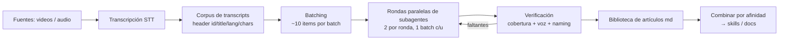

# Moonshine

Metodología reproducible para convertir un corpus de charlas/videos en una
biblioteca de **artículos standalone** escritos por agentes, y de ahí en
conocimiento destilado (skills, documentación, base para combinar por afinidad).

No está atado a ninguna conferencia ni dominio: sirve para cualquier corpus de
material hablado (charlas, webinars, podcasts, cursos) que se quiera convertir
en texto de calidad editorial.

## El pipeline



### Principios

1. **Artículo, no narración.** Cada pieza es el artículo de la charla: alguien
   que no vio el video lo lee como pieza standalone y se lleva el contenido.
   Prohibido el metalenguaje ("el ponente", "en esta charla").
2. **Spec centralizada.** Un único archivo de spec (`spec/article-spec.md`) es
   la referencia de formato. Cada subagente la lee ANTES de escribir y se lo
   exige explícitamente en el dispatch.
3. **Rondas chicas y verificadas.** 2 subagentes en paralelo por ronda, 1 batch
   por subagente. Entre rondas: verificación automática + muestreo manual.
   Los errores de formato se detectan a los ~20 artículos, no a los 1000.
4. **Naming por contenido.** El nombre de archivo es el slug del título del
   artículo (descriptivo, corto); el identificador del video vive en la línea
   de metadatos interna como trazabilidad.
5. **Trazabilidad absoluta.** Todo artículo referencia su transcript por id en
   los metadatos. La verificación de cobertura es por id, no por nombre.
6. **Modelo-agnóstico.** El pipeline no hardcodea proveedores ni claves.
   Puede correr contra cualquier endpoint OpenAI-compatible (p. ej. los modelos
   de [nan.builders](https://nan.builders)) o cualquier CLI de agente.

## Estructura

```
moonshine/
├── README.md                  # este archivo
├── AGENTS.md                  # manual del agente orquestador
├── spec/article-spec.md       # spec de formato (fuente única de verdad)
├── skills/
│   ├── writeup-author/        # skill del subagente escritor
│   └── writeup-verify/        # skill del verificador
├── scripts/
│   ├── make_batches.py        # corpus de transcripts → batches.json
│   └── verify.py              # cobertura, naming, voz, metadatos
└── templates/
    └── dispatch-prompt.md     # plantilla del prompt por batch
```

## Convención de transcripts

Cada fuente (evento/canal/serie) vive en un directorio; cada ítem es un `.txt`
con header de 4 líneas y separador:

```
<id>
<titulo original>
<lang>
<chars>
---
<cuerpo del transcript>
```

- `<chars>` = cantidad de caracteres del cuerpo. Si es < 50 (prácticamente solo
  música/sin habla), el artículo es breve e indica que no hay contenido hablado.
- El escritor SIEMPRE salta el header: lee desde `---`.

## Uso rápido

```bash
# 1. Generar batches desde el corpus de transcripts
python scripts/make_batches.py --root /ruta/corpus --out _batches.json --batch-size 10

# 2. Verificar el corpus de artículos producidos (en cualquier momento)
python scripts/verify.py --root /ruta/corpus --batches _batches.json \
    --banned 'el ponente|en esta charla|el orador|durante la charla'

# 3. El orquestador despacha rondas según AGENTS.md, verifica entre rondas
#    y registra progreso en _progress.json
```

## Lecciones incorporadas

Ver [AGENTS.md](AGENTS.md) § Lecciones: outputs zombie tras un reset, stops que
llegan tarde, cambios de regla a mitad de ronda (steering), y el orden correcto
reset → spec → redispatch.

## Estado

Metodología en uso activo sobre un corpus real de ~1150 charlas. Los scripts y
la spec se endurecen con cada ronda.
