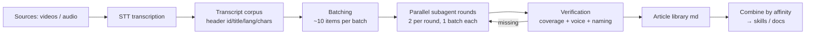

# Moonshine

Reproducible methodology for turning a corpus of talks/videos into a library
of **standalone articles** written by agents, and from there into distilled
knowledge (skills, documentation, affinity-based combinations).

Not tied to any conference or domain: it works for any corpus of spoken
material (talks, webinars, podcasts, courses) that you want to turn into
editorial-quality text.

## The pipeline



### Principles

1. **Article, not narration.** Every piece is the article OF the talk: someone
   who never watched the video reads it as a standalone piece and gets the
   content. Meta-language is forbidden ("the speaker", "in this talk").
2. **Centralized spec.** A single spec file (`spec/article-spec.md`) is the
   format reference. Every subagent reads it BEFORE writing, and the dispatch
   prompt demands it explicitly.
3. **Small verified rounds.** 2 subagents in parallel per round, 1 batch each.
   Between rounds: automated verification + manual sampling. Format errors
   surface at ~20 articles, not at 1000.
4. **Content-based naming.** The filename is the slug of the article title
   (descriptive, short); the video id lives in the internal metadata line as
   traceability.
5. **Absolute traceability.** Every article references its transcript by id in
   the metadata. Coverage verification is by id, never by filename.
6. **Language is a parameter, asked once.** Default article language is
   **English**, but the orchestrator MUST ask the user which language the
   writeups should use before dispatching the first round, and record the
   choice in every dispatch prompt (`{{LANGUAGE}}`).
7. **Model-agnostic.** The pipeline hardcodes no providers or keys. It can run
   against any OpenAI-compatible endpoint or any agent CLI.

## Repository layout

```
moonshine/
├── README.md                  # this file
├── AGENTS.md                  # orchestrator agent manual
├── spec/article-spec.md       # format spec (single source of truth)
├── skills/
│   ├── writeup-author/        # writer subagent skill
│   └── writeup-verify/        # verifier skill
├── scripts/
│   ├── make_batches.py        # transcript corpus → batches.json
│   └── verify.py              # coverage, naming, voice, metadata
└── templates/
    └── dispatch-prompt.md     # per-batch prompt template
```

## Transcript convention

Each source (event/channel/series) lives in a directory; each item is a `.txt`
with a 4-line header and separator:

```
<id>
<original title>
<lang>
<char count>
---
<transcript body>
```

- `<chars>` = character count of the body. If < 50 (essentially music / no
  speech), the article is brief and states there is no spoken content.
- The writer ALWAYS skips the header: reads from `---` onward.

## Quick start

```bash
# 1. Build batches from the transcript corpus
python scripts/make_batches.py --root /path/corpus --out _batches.json --batch-size 10

# 2. Verify the produced article corpus (any time)
python scripts/verify.py --root /path/corpus --batches _batches.json            # English banned phrases (default)
python scripts/verify.py --root /path/corpus --batches _batches.json --lang es  # Spanish banned phrases

# 3. The orchestrator dispatches rounds per AGENTS.md, verifies between rounds
#    and records progress in _progress.json
```

## Incorporated lessons

See [AGENTS.md](AGENTS.md) § Hard conventions: the id (not the slug) is the
matching key, never trust remembered ids/titles, duplicate ids across files,
and the metadata line is excluded from the voice scan.

## Status

Methodology in active use on a real corpus of ~1150 talks. Scripts and spec
are hardened with every round.
